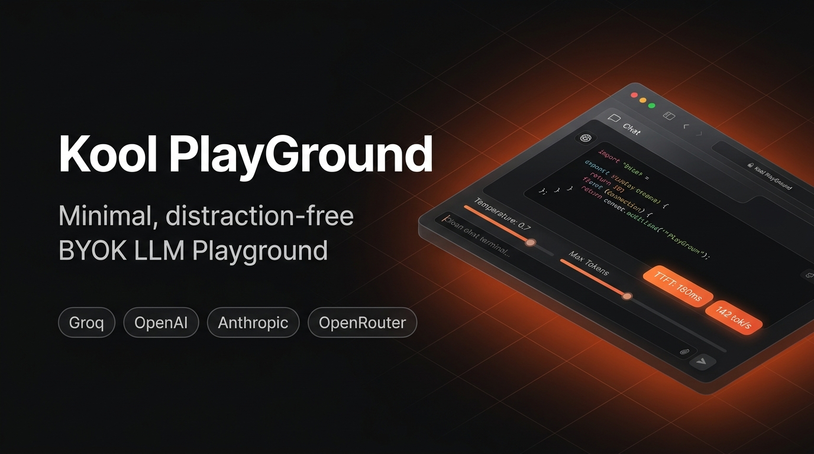

# Kool PlayGround



A minimal, distraction-free, bring-your-own-key (BYOK) LLM playground inspired by Groq Playground. Test prompts across multiple model providers with full sampling controls, live prompt shot-type detection, web search grounding, and client-only API key management.

## Features

- **Flexible BYOK API Key Vault & Smart Launch**
  - Supports **Groq** (defaulting to `openai/gpt-oss-120b`), **OpenAI**, **Anthropic**, **OpenRouter**, and any **Custom OpenAI-Compatible** endpoint (e.g., Together, Fireworks, DeepSeek, Ollama), plus a **Built-in Sandbox** mode.
  - Launches directly into the API Key Vault on first visit when no keys are saved, and enters the workspace immediately on return visits with saved keys.
  - **Session-only mode (default)**: API keys stay strictly in browser memory and clear automatically on page refresh or when you click **End session**.
  - **Local browser storage mode**: Opt in to persist keys in your browser's `localStorage` across visits, switch modes per provider, or clear individual/all keys at any time.
  - **Stateless key verification**: Optional connection check against the selected provider without storing or logging credentials on any server.
- **Live Per-API-Key Model Discovery**
  - Queries each provider's live `/models` endpoint using your active key, filters out non-chat models (embeddings, Whisper, TTS, image, moderation), auto-selects an available model if the default isn't enabled on your key, and provides instant search filtering when >10 models are available.
- **Advanced Parameter Controls & Presets**
  - Paired sliders and numeric inputs for **Temperature**, **Top P**, **Max Completion Tokens**, **Frequency Penalty**, **Presence Penalty**, **Seed**, **Stop Sequences**, and **Reasoning Effort** (on supported models).
  - One-click **Precise**, **Balanced**, and **Creative** sampling presets, plus a live workspace parameter readout and per-response parameter stamps so you can compare how settings affect output.
- **Live Prompt & Response Telemetry**
  - Real-time composer **token count**, **word count**, and automatic **Zero-shot**, **One-shot**, and **Few-shot** classification (accounting for demonstrations in both the user prompt and system prompt).
  - Per-response assistant token/word estimates paired with a live **token-limit capacity progress bar** that fills as the model generates.
- **Browser Search Grounding**
  - Toggle **Browser Search** to use native web search on supported models (`openai/gpt-oss-*`, `groq/compound*`, Sandbox) or live web snippet grounding with numbered clickable source citations on any other model.
- **Developer Workflow Tools**
  - Collapsible **System Prompt** editor paired with a **Prompt Library** drawer to save, search, edit, and load recurring system prompts locally.
  - Global keyboard shortcuts: `Cmd/Ctrl + Enter` to send, `Cmd/Ctrl + K` to open API Keys, and `Cmd/Ctrl + N` to start a new chat.
  - **JSON Mode** and **Streaming / Non-streaming** toggle with mid-stream **Stop** cancellation.
  - **View Code & Export** modal generating runnable `cURL`, `JavaScript`, and `Python` snippets (using env-var placeholders, never raw keys) plus one-click **Export as Markdown (`.md`)** preserving full conversation formatting, reasoning traces, and citations.
  - **Saved Sessions** stored locally in your browser (without API keys) with active-session highlighting, Markdown + GFM rendering with copyable code blocks, measured response timing (elapsed time, TTFT, tokens/sec), and **Light / Dark** themes.

## Tech Stack

- **Frontend**: React 19, TypeScript, Tailwind CSS v4, `motion/react`, Lucide icons, `react-markdown` + `remark-gfm`
- **Backend**: Express + Vite middleware (`server.ts`) providing a stateless BYOK streaming proxy, key verification and live `/models` discovery routes, live web search grounding, and optional server-side sandbox
- **Testing**: Node's built-in test runner (`node:test`) via `tsx`

## Getting Started

### Prerequisites

- Node.js 20+ (22+ recommended)
- npm

### Installation

```bash
git clone <your-repo-url>
cd <your-repo-directory>
npm install
```

### Environment Variables (Optional)

Copy `.env.example` to `.env` if you want to enable the optional Built-in Sandbox route or configure a custom app URL:

```bash
cp .env.example .env
```

> **Note:** You do **not** need any server `.env` keys to use Groq, OpenAI, Anthropic, OpenRouter, or Custom OpenAI-compatible endpoints—simply paste your API key directly in the **API Key Vault** inside the UI.

### Development

```bash
npm run dev
```

Open [http://localhost:3000](http://localhost:3000).

### Production Build & Run

```bash
npm run build
NODE_ENV=production npm start
```

### Type Checking & Unit Tests

```bash
npm run lint
npm test
```

## Deploy to Firebase

This repository is pre-configured so you can clone it from GitHub and deploy straight to Firebase with no extra setup.

### Option 1: Firebase Hosting (Static — Free Spark Plan)

Best for instant, zero-cost deployment. When hosted statically on Firebase Hosting, Kool PlayGround automatically switches BYOK requests (**Groq**, **OpenAI**, **Anthropic**, **OpenRouter**, and CORS-enabled **Custom** endpoints) to direct browser-to-provider API calls—including key verification, streaming, sampling controls, JSON mode, and native Groq web search (`openai/gpt-oss-*` / `groq/compound*`).

```bash
git clone <your-repo-url>
cd <your-repo-directory>
npm install
npm install -g firebase-tools

firebase login
firebase use --add        # select your Firebase project
firebase deploy           # automatically runs `npm run build` and deploys dist/
```

Or deploy directly to a specific project ID in one command:

```bash
firebase deploy --only hosting --project <your-firebase-project-id>
```

### Option 2: Firebase App Hosting (Full-Stack Node.js)

Use **Firebase App Hosting** if you also want the Express `/api/*` backend for server-side web search grounding on non-native models and the optional Built-in Sandbox route:

1. Push this repository to GitHub (keep `apphosting.yaml`, `package.json`, and `server.ts`).
2. In the [Firebase Console](https://console.firebase.google.com/), open **App Hosting** and connect your GitHub repository.
3. *(Optional)* To enable the Built-in Sandbox route, store a Gemini API key secret and uncomment `GEMINI_API_KEY` in `apphosting.yaml`:
   ```bash
   firebase apphosting:secrets:set GEMINI_API_KEY
   ```

## Security & Privacy Model

- API keys entered in the UI are never written to a server database or logged to disk.
- **Session-only** keys live solely in React state and disappear immediately upon refreshing the tab or clicking **End session**.
- **Saved** keys are written only to your browser's `localStorage` and can be demoted to session-only or cleared at any time.
- Exported code snippets always substitute environment variable placeholders (`$GROQ_API_KEY`, `$OPENAI_API_KEY`, etc.).

## License

Apache-2.0
